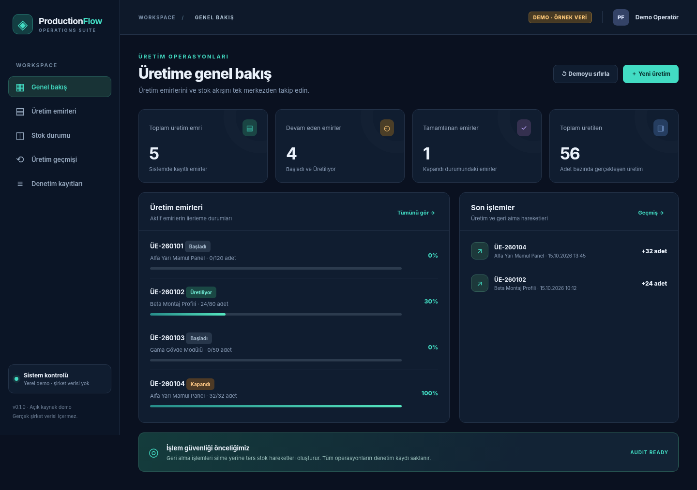
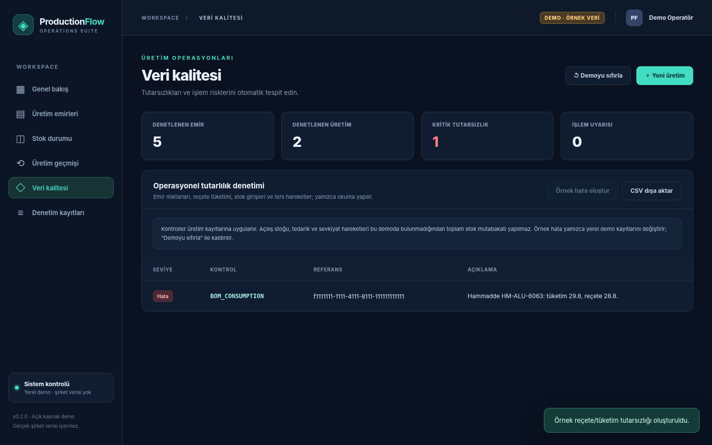

# ProductionFlow Manager

**Üretim emri, reçete, stok, güvenli geri alma ve veri tutarlılığı kontrolü**  
*A portfolio-ready manufacturing operations system built with .NET 10, SQL Server, and vanilla JavaScript.*

[](https://github.com/rhodeskannagi/ProductionFlow-Manager/actions/workflows/ci.yml)   

> **Live interaction without a database:** Download `ProductionFlow-Demo.html` and open it in Chrome or Edge. This self-contained demo works offline on synthetic data. No company database, ERP credentials, or confidential records are included.



### Data-integrity diagnostics



## Yeni: Windows masaüstü (v0.4.0)

C# WinForms sürümü: otomatik SQL bağlantısı, boş ve bağımsız veritabanı kurulumu, Windows DPAPI ile şifreli giriş profili, ürün/stok/reçete/emir yönetimi, kalıcı çevrimdışı demo, üretim önizlemesi, gerekçeli geri alma, arama/filtreleme, stok/geçmiş ve CSV aktarımı. API ve masaüstü SQL iş mantığı `ProductionFlow.Core` içinde ortaktır.

**Çalıştırma ve test adımları:** [Masaüstü kılavuzu](docs/DESKTOP.md). Windows iş akışı indirilebilir EXE paketini artifact olarak üretir. Demo için SQL veya ayrı .NET kurulumu gerekmez.

## What this demonstrates / Ne işe yarar?

| Module | Features | Skills demonstrated |
|---|---|---|
| Production orders | Planned/produced amounts, order status, filtering | ERP / MRP business logic |
| Bill of materials | Preview material requirements before booking | SQL joins, validations |
| Production booking | Atomic inventory consumption + finished goods receipt | Transactions, isolation, locking |
| Safe reversal | Compensating ledger entries, original history retained | Auditability, recovery design |
| Data quality | Six read-only diagnostic categories + CSV export | SQL reporting, troubleshooting |
| Demo UI | Responsive, standalone, local state | HTML, CSS, JavaScript |
| Engineering | Repeat-safe request keys, tests, CI | Defensive coding, GitHub Actions |

**Yeni v0.2.0:** *Veri kalitesi* ekranında test ortamına örnek bir reçete tüketim hatası eklemek, hatayı otomatik görmek ve CSV raporuna aktarmak mümkün. Bu işlem yalnızca **kurgu demo verilerini** etkiler. “Demoyu sıfırla” başlangıç haline döner.

Bağımsız SQL kurulumu ve güvenlik ayrıntıları: [Veritabanı kılavuzu](docs/DATABASE.md).

## Quick start: no installation

1. Open **`ProductionFlow-Demo.html`** in Chrome/Edge.
2. Test production booking, remaining quantity checks and undo history.
3. Open **Veri kalitesi** → **Örnek hata oluştur** to trigger a genuine consumption-mismatch check.
4. Export the report as CSV or reset the synthetic data.

The offline demo stores only its local synthetic state in the browser. If you want to serve the split source:

```powershell
cd src/ProductionFlow.Api/wwwroot
python -m http.server 5500
```

Visit <http://localhost:5500>.

## SQL Server + .NET development

Requirements: .NET 10 SDK, SQL Server 2022 (or Docker Desktop), SSMS.

1. Copy `.env.example` to `.env` and choose a **new strong demo password**.
2. Start SQL Server: `docker compose up -d sqlserver`
3. In SSMS, connect to `localhost,14333` (SQL login `sa`, chosen password). Run **`db/001_create_and_seed.sql`** completely. It creates a **separate** `ProductionFlowDemo` database.
4. Start API: `docker compose up --build -d api`
5. Open <http://localhost:5080> and check the **SQL SERVER BAĞLI** indicator.

Run independent SQL diagnostics in SSMS with `db/002_integrity_checks.sql`.

For development without Docker:

```powershell
cd src/ProductionFlow.Api
$env:ConnectionStrings__ProductionFlow="Server=localhost;Database=ProductionFlowDemo;Integrated Security=True;TrustServerCertificate=True;"
dotnet run --urls http://localhost:5080
```

**Important:** Use an isolated demo database only. The app has no authentication or role-based permissions and is **not ready for live business deployment**.

## HTTP API

| Method | Route | Purpose |
|---|---|---|
| GET | `/api/health` | Health probe |
| GET | `/api/overview` | Orders, inventory, history, KPIs |
| GET | `/api/integrity` | Read-only integrity report |
| POST | `/api/orders/{id}/preview` | Requirements check, `{ "quantity":5 }` |
| POST | `/api/orders/{id}/produce` | Atomic production, `{ "quantity":5, "requestId":"<uuid>", "operator":"Demo" }` |
| GET | `/api/runs/{id}/undo-preview` | Reversal requirements check |
| POST | `/api/runs/{id}/undo` | Atomic inverse entries, `{ "reason":"Yanlış miktar girildi", "operator":"Demo" }` |

## Data-integrity rules

- `ORDER_QUANTITY`: Quantity on the order differs from the sum of its non-reversed runs.
- `ORDER_STATUS`: Status is inconsistent with planned vs. produced quantity.
- `RUN_OUTPUT`: Finished-goods receipt count or quantity is incorrect.
- `BOM_CONSUMPTION`: Raw-material consumption differs from the recipe.
- `REVERSAL_LEDGER`: Reversal deltas do not balance original movements.
- `INVALID_STOCK`: Negative or invalid on-hand balance.
- `UNDO_BLOCKED` *(warning)*: Finished-goods stock is insufficient for undo; this is not necessarily data corruption.

**Accounting scope:** Opening inventory, purchase receipts and shipments are outside this demo. The checks intentionally do **not** claim to reconcile closing stock from the production-only ledger.

## Tests / CI

```sh
npm test
npm run check
node scripts/build-standalone.mjs
dotnet build src/ProductionFlow.Api/ProductionFlow.Api.csproj
```

**16 Node tests** passed in the authoring environment, covering booking, reversal, duplicate prevention, malformed inputs, order reconciliation, BOM faults, missing receipts, compensating entries, and CSV safety. The browser demo was also exercised for production → undo → integrity → CSV download.

On 27 October 2026, the API and Windows desktop Release builds passed with zero warnings and errors. All 35 platform-independent C# core checks and 16 existing Node tests passed. Windows GUI interaction, Docker build and live SQL integration were not executed in this environment; see the desktop acceptance checklist before operational use.

## Design & limitations

- SQL transaction scope `SERIALIZABLE`, row locks and `RequestId` uniqueness protect writes.
- Reversals retain original rows and write equal/opposite stock movements.
- A report endpoint executes read-only aggregate SQL; frontend demo runs matching checks against synthetic in-memory data.
- No authorization, approval routing, production secrets, real ERP integration, multi-warehouse inventory or external accounting connectors in this portfolio project.

See [Architecture](docs/ARCHITECTURE.md) and [Engineering case study](docs/CASE_STUDY.md).

## Repository

[Source and build status](https://github.com/rhodeskannagi/ProductionFlow-Manager)

```sh
git clone https://github.com/rhodeskannagi/ProductionFlow-Manager.git
cd ProductionFlow-Manager
```

Keep `.env` local; use `.env.example` for configuration guidance.

## Privacy & license

100% fictitious dataset. No employer database, source procedure, account, hostname, customer details or private credentials. **MIT License.**
