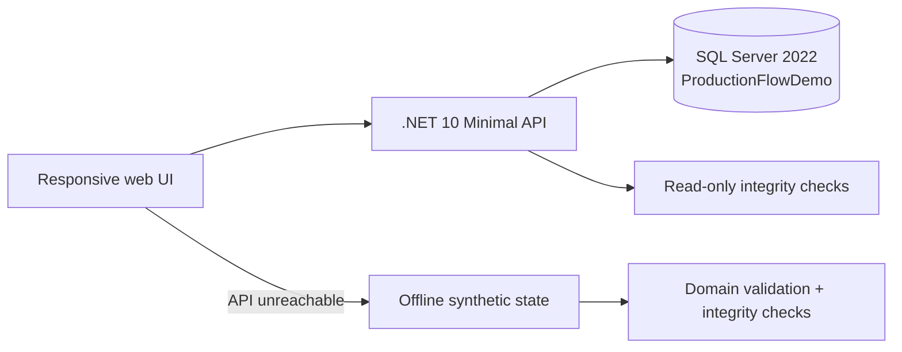

# Architecture & safety

The standalone demo is built from the same frontend modules with `scripts/build-standalone.mjs`; it uses only synthetic browser-local data.

## Relational schema

- **Products**: finished and raw material items with unit and kind.
- **Recipes**: one product/component with a per-unit multiplier (one level; no nested recipes yet).
- **Orders**: planned and produced quantities, operational status and row version.
- **StockBalances**: nonnegative on-hand quantity for one logical warehouse.
- **ProductionRuns**: run, unique request ID and optional reversal metadata.
- **StockMovements**: append-only signed delta rows; `P` finished receipt, `C` consumption, `U` compensating entry.
- **AuditEvents**: operator-action audit log.

## Production transaction

1. Start `SERIALIZABLE` SQL transaction.
2. Reject duplicated `RequestId` and lock the selected order row.
3. Validate remaining quantity, material stock and bill of materials.
4. Write run, material-consumption and finished-goods movements.
5. Apply stock balances, order status and audit event; commit.
6. Roll back on exception.

## Reversal transaction

1. Lock order, original run and affected stock rows.
2. Validate that the run is not already reversed and original postings are coherent.
3. Verify enough finished-goods stock remains for compensation.
4. Append balancing entries; change run/order state; append audit event; commit.
5. Roll back on exception.

## Data quality

`/api/integrity` uses independent **read-only SQL aggregate** queries for the following checks:

- Order amount and status consistency.
- Finished-goods receipt count and amount per run.
- Recipe vs. actual raw-material usage.
- Reversal amounts net to zero by product and run.
- Whether a currently active run can be undone without negative finished stock.

The browser's `auditIntegrity` function mirrors these checks for synthetic data. Report endpoints do not modify records. The **SQL Server script** `db/002_integrity_checks.sql` allows manual inspection in SSMS. The data-quality checks intentionally do not infer opening inventory or external purchase/shipment movement values.

## Security boundary

No real business/company data. No linked ERP systems. The API currently has no authentication/authorization and Docker binds API/SQL ports to loopback on the host: localhost **only**. Before production use, implement identity and permissions, secret management, approval flow, backup/restore procedures, SQL integration tests and concurrency testing.
