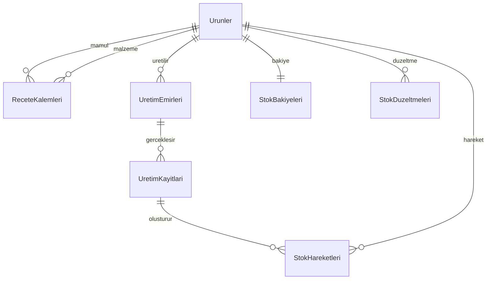

# UretimAkis — veri modeli ve mimari karari

27 Ekim 2026. Yeni kurulumun veritabani adi `UretimAkis`; adlarda c, g, i, o, s, u kullanilir. Tablo/sutun isimleri Turkce ASCII, kullanici ekran metinleri normal Turkcedir. SQL sistem nesneleri ve C#/HTTP sozlesmeleri yeniden adlandirilmaz.

## v0.5'te uygulanan adlar

| Once | Simdi | Gorev |
|---|---|---|
| Products | Urunler | Mamul ve malzeme kartlari |
| Recipes | ReceteKalemleri | Mamulun malzeme tuketimi |
| Orders | UretimEmirleri | Planlanan ve uretilen miktar |
| ProductionRuns | UretimKayitlari | Her uretim ve geri alma kaydi |
| StockMovements | StokHareketleri | Uretim giris, tuketim ve ters hareket |
| StockBalances | StokBakiyeleri | Hareketlerle mutabik mevcut stok |
| InventoryAdjustments | StokDuzeltmeleri | Ilk stok ve gerekceli duzeltmeler |
| AuditEvents | IslemGunlugu | Kim, ne zaman, hangi islem |
| AppSchema | UygulamaSemasi | Sahiplik ve sema surumu |

Ornek sutunlar: `UrunId`, `StokKodu`, `Ad`, `Birim`, `EmirId`, `PlanlananMiktar`, `UretilenMiktar`, `UretimId`, `MiktarDegisimi`, `OlusturmaZamani`. Tam eslestirme: [ISIM_ESLESTIRME.json](ISIM_ESLESTIRME.json).

## Onerilen uretim modeli — henuz uygulanmayan genislemeler

Microsoft'un uretim belgeleri tek bir evrensel SQL semasi sunmuyor; asagidaki tasarim bu proje icin cikarimdir. Islemsel, normalize iliskisel model ana kayittir. Yildiz sema daha sonra raporlama icin ayri kurulabilir; canli uretim kaydinin yerine gecmez.

1. **Recete surumu:** `Receteler -> ReceteSurumleri -> ReceteKalemleri`. Onay ve gecerlilik tarihleri tutulur. Emir acilirken secilen recete kalemleri `EmirMalzemeleri` tablosuna kopyalanir. Sonraki recete degisikligi eski uretimi yeniden hesaplamaz. Mevcut surum bunun yerine uretim gecmisi bulunan mamulun recetesini kilitler.
2. **Operasyon rotasi:** `Rotalar -> RotaSurumleri -> RotaAdimlari`; adimlar `Operasyonlar` ve `IsMerkezleri` ile baglanir. Emir icin `EmirOperasyonlari` kopyasi; planlanan/gercek sure ve kapasite takibi. Ilk etapta sirali rota yeterlidir.
3. **Depo ve izlenebilirlik:** `Depolar -> DepoKonumlari`, `Partiler` ve gerekirse `SeriNumaralari`. Stok hareketinde urun/depo/konum/parti anahtarlari; bakiye de ayni boyutlarda tutulur. Bugunku surum urun bazinda tek stok tutar.
4. **Kalite ve fire:** `KaliteKontrolleri`, `KaliteSonuclari`, `FireKayitlari`. Uygun, karantina ve hurda miktarlari birbirinden ayrilir; stokta kullanilabilirlik etkisi acikca tanimlanir.
5. **Siparis ve ihtiyac:** `Siparisler -> SiparisKalemleri -> UretimEmirleri`; malzeme rezervasyonlari ve satin alma ihtiyaclari. Bu, mevcut uretim emri tablosundan ayri bir satis siparisi katmanidir.

Baglantilar ID tabanli FOREIGN KEY ile kurulmalidir. Kodlar ayrica UNIQUE olmalidir. Uretim + malzeme tuketimi + mamul girisi tek transaction icinde yazilir. Gecmis hareketler silinmez; ters hareketle duzeltilir. Stok sorgularinda NOLOCK ile tutarlilik feda edilmez. Indeksler gercek sorgu plani ve IO olcumleriyle secilir; bu degisiklik icin hizlanma olcumu yapilmadi.

## Uygulama baglantisi

Su an: **WinForms -> SQL Server** (Windows DPAPI ile korunan yerel baglanti profili). Yeni veritabani ayni SQL orneginde Mega'dan bagimsizdir; sunucu kaynaklari ortaktir.

Cok kullanicili hedef icin onerim: **WinForms -> HTTPS API -> SQL Server**. Kimlik/yetki ve is kurallari API'de uygulanir, SQL parolasi istemcilere dagitilmaz. Katmanlarin ayrilmasi bakim ve olcekleme imkani verir. Bu, bir sonraki mimari adimdir; mevcut masaustu SQL baglantisi bu surumde API'ye cevrilmedi. API'yi dogrudan internete acmak bu onerinin parcasi degildir.

## Eski kayitlarla gecis

- v0.4 baglanti profili korunur. Eski `ProductionFlowManager` adli veritabani varsa ayni veritabaninda tablo/sutunlar sema v1'den v2'ye transaction icinde donusturulur; veriler kopyalanmaz veya silinmez.
- Eski veritabaninin adi otomatik degistirilmez; mevcut baglanti/yedekleme islerini bozmamak icin yeni ad yalniz yeni kurulum varsayilanidir. Eski veriler varken ayarlara yeni ad yazmak ayri bos veritabani olusturur, veri tasimaz.
- Gecis oncesi yedek alin, eski uygulama/API istemcilerini kapatin ve tum istemcileri birlikte guncelleyin. Eski surum yeni Turkce tablo adlariyla calismaz. SQL hesabinin ilk geciste sema degistirme yetkisi gerekir; rutin acilista gerekmez.
- Sahiplik kimligi veya surumu uyusmayan dolu veritabanina dokunulmaz. `db/001_create_and_seed.sql` yalniz yeni web demo kurulumudur; eski web demo veritabanini otomatik tasimaz.

## Kaynaklar

- [Microsoft: uretim emri yasam dongusu ve emre recete/rota kopyalanmasi](https://learn.microsoft.com/en-us/dynamics365/supply-chain/production-control/create-production-orders)
- [Microsoft: receteler ve surumler](https://learn.microsoft.com/en-us/dynamics365/supply-chain/production-control/bill-of-material-bom)
- [Microsoft: rotalar ve operasyonlar](https://learn.microsoft.com/en-us/dynamics365/supply-chain/production-control/routes-operations)
- [Microsoft: FOREIGN KEY iliskileri](https://learn.microsoft.com/en-us/sql/relational-databases/tables/create-foreign-key-relationships?view=sql-server-ver17)
- [Microsoft: N-tier uygulama katmanlari](https://learn.microsoft.com/en-us/visualstudio/data-tools/n-tier-data-applications-overview?view=visualstudio)
